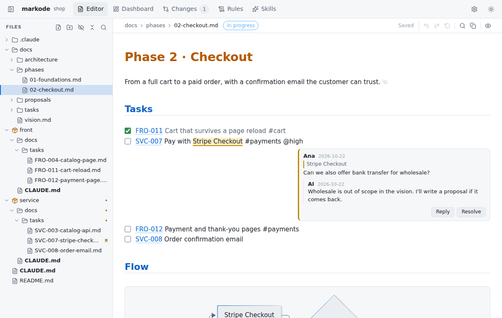
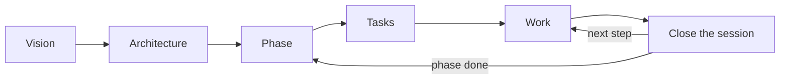

#  markode

[](https://github.com/rafiqui1987/markode/actions/workflows/ci.yml)
[](LICENSE)

**Your project's Markdown, made for two readers: you and your AI agent.**

Run `markode` in any repository and every `.md` file (`README.md`, `CLAUDE.md`, `AGENTS.md`, `docs/`…)
opens in one editor that is also the preview. You read and edit documents, not syntax. The files stay
plain Markdown, saved exactly as written, so Git diffs stay clean and any agent reads them as they are.

On top of the viewer, and only if you want it, markode helps you and your agent work from the same
docs: short instructions that point instead of repeat, tasks that remember where you stopped, and
decisions you answer with a click instead of a wall of chat.

<picture>
  <source media="(prefers-color-scheme: dark)" srcset="docs/assets/screenshot-dark.png">
  
</picture>

## The markode philosophy

AI agents made project docs important again, and they made them worse. `CLAUDE.md` files grow into
hundreds of lines of generic advice, folder listings the agent can read by itself, and the same
decision copied in three places. They cost tokens on every message, the agent still searches the whole
repository, and nobody keeps them up to date. Meanwhile the human, who has to review all of it, reads
raw Markdown in a split screen or not at all.

markode is built on five ideas:

**1. Write less, point better.** The docs are a **map**, not an encyclopedia. Write only what the code
can't tell: decisions and why, hidden conventions, the state of the work. Each fact lives in one place
and everything else links to it. A doc is created when there is something real to put in it, never as
an empty template.

**2. The docs are the memory, not the chat.** Work lives in task files with a status and a next step.
Decisions live in the architecture docs. Tomorrow, a new session (or a teammate, or another agent) reads
the map, finds what is in progress and picks up where you stopped, without you explaining it again.

**3. One plain file, two ways to read it.** You see rendered tables, diagrams and checklists, and you
comment like in Word. The agent sees plain Markdown and HTML comments, invisible on GitHub. Nothing is
converted, nothing is locked in a database: delete markode tomorrow and every file still works.

**4. Talk through the docs.** When a question has options, the agent writes a proposal with diagrams
and you answer by ticking and commenting. Your comments and edits reach the agent while it works. The
decision ends up in the docs it changes, not lost in a conversation.

**5. Only what you ask for, for any agent.** The viewer writes nothing to your project. Everything
else is a module you turn on or off, and turning it off removes exactly what markode added. It works
with Claude Code, Codex, Cursor, Gemini, Copilot and any agent that reads `CLAUDE.md`, `AGENTS.md` or
skills.

What it looks like in a repository with a front end and a back end:

```tree
CLAUDE.md                     # the map: projects, where their docs live, how to start a session
docs/                         # vision, shared decisions, phases, work across projects
service/
  CLAUDE.md                   # what this project is and its commands, nothing more
  docs/tasks/SVC-007-....md   # in-progress · next step: retry payments on timeout
front/
  docs/tasks/FRO-012-....md   # blocked · waits on SVC-007
```

Yesterday you worked in `service/` and `front/`. Today you ask the agent *"what's pending?"*
(`/markode-status`). It reads the map, scans only the task files of each project, and answers:
SVC-007 is in progress and its next step is the retry; FRO-012 is blocked on it; phase 2 has four
pending tasks; and one change in `front/` isn't covered by any task. No digging through the code, no
explaining it all again.

markode can't force an agent to follow the map, but it makes the right path the shortest one.

## Quick start

Requires Node.js 20 or newer. From the root of any project (monorepos included):

```bash
npx @rafiqui987/markode
```

The editor opens at `http://localhost:4319` (it only listens on `127.0.0.1`). The very first time,
markode asks a single question: what to install besides the viewer.

| Choice | What you get |
|---|---|
| **Viewer only** | See and edit every `.md` file. Nothing is written to the project. |
| **Viewer + AI agent** (recommended) | The viewer, plus everything your agent needs to work with these docs: its skill, working rules, proposals, comments, live changes and translations. |
| **Complete** | All of the above, plus the dashboard and a docs structure for vision, architecture, phases and tasks. |
| **Choose the modules** | Pick each module from the list below. |

Your answer becomes the default for new projects (`~/.markode/defaults.json`), so they don't ask again;
change it with `markode setup`. Everything else is detected: the main doc (`CLAUDE.md`, `AGENTS.md`
or both), the agents the project uses, the language its docs are written in, the projects of a
monorepo, and an existing OpenSpec or Spec Kit setup.

### Modules

Turn any of them on or off later in **Settings → Features** (or `markode features <module> on|off`).
Turning one off removes only what markode added; your docs, tasks, proposals and comments stay.

| Module | What it does | What it writes |
|---|---|---|
| **AI agent** | Teaches your agent how to work with these docs, and lets you comment on any text for it. | The `markode` skill in `.claude/skills/` and/or `.agents/skills/`, a "Working rules" section in the main doc with the source language |
| **Working rules** | Rules the agent follows in this project, chosen in the Rules tab. Needs the AI agent. | Inside the "Working rules" section |
| **Proposals** | The agent answers big questions with a doc you answer by ticking options and commenting. Needs the AI agent. | The `markode-proposals` skill, a "Proposals" section in the main doc |
| **Live changes** | Claude Code hears about your edits and comments while it works. Needs the AI agent. | Personal hooks in `.claude/settings.local.json` |
| **Translations** | Read and edit the docs in your language, translated by your browser or the agent. Needs the AI agent. | Only `.markode/` (personal) |
| **Dashboard and tasks** | A Dashboard tab with docs, proposals, phases and tasks; with the AI agent, also the structure for them (the markode method). | `docs/`, the `markode-*` method skills, a "Workflow" section in the main doc |
| **Skills** | A tab to browse and edit your agents' skills and add them to the project. | Nothing |
| **Hide in VS Code** | Hides `.markode/` from the VS Code explorer. | `.vscode/settings.json` |

markode keeps its own state in `.markode/`, which ignores itself in git (`.markode/.gitignore`), so
your `.gitignore` is never touched. Sections it writes in your main doc sit between markers like
`<!-- markode:rules:start -->` and `<!-- markode:rules:end -->`; the rest of the file is yours.

## What it does



### 1. Every Markdown file of the project, in one place

A file tree with every `.md` in the folder where you run it, folders first. Search, expand or collapse
all, create files and folders inline, hide what you don't need (`.markodeignore`) and delete from the
right-click menu. Resize the sidebar by dragging its edge, or hide it for more room. Links between docs
work: click a relative `.md` link and it opens in markode.

### 2. Read the document, not the syntax

There is no "editor | preview" split. The **markode view** renders the document as it looks and lets
you write in it directly: headings, lists and quotes keep their marks out of the way, and the cursor
never lands inside them. Code blocks, tables, math and images show their Markdown only when you click
to edit them. One button switches the open file to the **Markdown view** (plain source) and back,
keeping your place; every file opens in the markode view.

The toolbar next to the breadcrumb has undo, redo, **discard** (back to how the file was when you
opened it), **find and replace** (`Ctrl+F`, `Ctrl+H`), **copy** as Markdown or as formatted text
for an email or a chat, and **PDF** export in A4 or A3, portrait or landscape, in markode's colors or plain.

### 3. Formatting without remembering syntax

- **`/` commands**: type `/` at the start of a line (or `Ctrl+Space` anywhere) for a menu of headings,
  lists, checklists, single-choice lists, tables, code blocks, diagrams, quotes, links, frontmatter,
  and comments and markers. Each option applies to the current line or to every selected line
  (numbered lists count up). Pick with the number or the arrows; `0`, `←` or `Backspace` goes back.
- **Selection toolbar**: select text to copy it or turn it into bold, italic, strikethrough, code or a
  link. Hover a button for its variants (`**`/`__`, `*`/`_`, `***`). Formatting inside a link's text
  keeps the link.
- **Links**: hover one to see its URL, copy it or edit its text and target; click to follow it.

### 4. Diagrams, tables and lists that are easy to work with

- **Mermaid diagrams** (flowcharts, sequences…) render in place and follow the light or dark theme.
  ` ```tree ` blocks draw folder structures.
- **Tables**: edit cells directly. Right-click to insert or delete rows and columns; drag borders to
  resize columns (view only, the file is not changed).
- **Tables from Excel or Google Sheets**: paste a range of cells and it becomes a Markdown table.
  `Alt+H` toggles whether the first row is a header.
- **Checklists**: click to tick. After `Enter` on a task, `Ctrl+Enter` ticks the new one.
- And more: KaTeX math (`$x^2$`, `$$…$$`), footnotes on hover, local and remote images, code blocks with
  only their language label showing.

### 5. Notes for the agent, invisible on GitHub

HTML comments are how a Markdown file talks to an agent without showing up for readers. markode makes
them visible and editable without the clutter (from the `/` menu, "Comments and markers"):

| You write | markode shows | Use it for |
|---|---|---|
| `<!-- any text -->` | a small icon; the text on hover | a hidden note for the agent or your future self |
| `<!-- region:auth:start -->` … `<!-- region:auth:end -->` | a bracket with the region's name | a section the agent should treat as one unit (renaming the start renames the end) |
| `<!-- tag:draft -->` | a tag chip | a marker the agent or a script can look for |
| `<!-- comment by Ana, …: … -->` | a comment thread, like in Word | a discussion on a piece of text (with the AI agent module) |

### 6. Work in your language

Most AI agents, and most teams, work best with docs in English. If English isn't easy for you, you
don't have to choose:

- Add a language to review the docs in, from **Settings → Document languages** or with
  `markode translate`: Spanish, French, Portuguese, German or Italian, or **type any other** (Japanese,
  Dutch…). markode shows **every doc in that language**. Read the architecture, tick tasks, write
  notes and fix a rule, all in your language.
- Pick who translates, in the same place:
  - **Browser** (the default in Chrome and Edge 138+): the browser's built-in translator, on your
    computer and offline once each language is downloaded. markode translates **by itself while it is
    open**, and only the paragraphs that changed.
  - **AI agent**: ask for **`/markode translate`** (markode has a button to copy it).
- Code blocks, diagrams, links, frontmatter keys and markode's markers are never sent to the engine,
  so a translation never breaks the Markdown. A **glossary** keeps names untranslated and fixes the
  translation of your terms.
- The files in the repository **stay in one source language**, detected from your docs on setup, so
  the agent and the rest of the team keep reading one consistent version.
- Your edits are kept as a translation. With the browser engine, **Bring my edits to the original**
  translates the paragraphs you edited back and shows each change; the source file changes only when
  you approve it. With the agent, `/markode translate` lists what would change and applies only what
  you approve.
- Translating is always on purpose: it never happens as a side effect of other work.
- The menus don't depend on the docs' language: pick English, Spanish, French, Portuguese, German or
  Italian in **Settings → General**, or any other language, translated once by your browser.

Example: you open `docs/tasks/T-004-login.md` in Spanish, add an acceptance criterion and tick two
others. After you approve your edits, the English file has the new criterion and the ticks, and the agent
works from it.

### 7. A method to plan and follow the work

The **Dashboard and tasks** module sets up the **markode method**, a way of organizing the project so
that you and the agent always know what is being built, how, and what comes next:

```tree
CLAUDE.md                  # short: map, commands, how to start and close a session
docs/
  tasks/T-001-....md       # one file per task: status, goal, acceptance checklist, next step, log
  vision.md                # when you define what the project is, for whom, what is out of scope
  architecture/<topic>.md  # with the first decision on that topic
  phases/02-checkout.md    # when you plan a milestone: goal, its tasks, definition of done
```



- **It starts small**: the setup creates only the task folder and its template. The agent creates the
  vision, architecture and phase docs from templates (skill `markode-method`) when there is something
  to write. A task's status lives only in its file: there is no index to keep in sync.
- **It knows what kind of project it is**, detected from its files, and writes only the guidance that
  kind needs (`markode init --custom` asks instead):

  | Kind | Detected by | Its docs |
  |---|---|---|
  | App | framework, `bin`, `Dockerfile`, `main.go`… | vision, architecture, phases |
  | Library | `main`/`exports` in a public package, Cargo `[lib]` | public API and versioning, changelog |
  | Mobile | React Native, Flutter, `android/` + `ios/` | releases and stores |
  | Data / ML | notebooks, `dvc.yaml`, `MLproject` | datasets, experiment log |
  | Infrastructure | Terraform, Pulumi, Helm, Kustomize | runbooks |
  | Microservices | several services + proto/OpenAPI or compose | contracts as shared architecture |

  It also recognizes monorepos with workspaces, a front end and a back end without workspaces, and
  folders of repositories; and if the project already has docs, it points the agent to them instead
  of creating new ones.
- **The main doc stays short** and points to `docs/`. If `CLAUDE.md` or `AGENTS.md` already exist,
  they are not rewritten: markode adds a "Workflow" section with the map and the session routine.
- **Sessions pick up where they stopped**: the agent looks for tasks `in-progress`, reads their "Next
  step" and tells you where you left off. `/markode-status` sums up what is in progress, blocked and
  pending, per project; `/markode-new-task` creates a task in the right place; and
  `/markode-close-session` logs what was done, the next step and the status.
- **Monorepos**: each project (`apps/web`, `services/api`… or each repository in a folder of repos)
  gets its own short `CLAUDE.md`/`AGENTS.md`, tasks with its own prefix (`WEB-001`, `API-001`),
  proposals and, with its first decision, a `docs/ARCHITECTURE.md`. The root main doc is the
  overview: a table of the projects, what each one is and where its docs live. The root `docs/` holds
  vision, phases and work across projects (`CORE-001`). The agent reads only the project it is
  working on.
- **Every agent finds the instructions**: Claude Code reads `CLAUDE.md`; Codex, Cursor, Gemini and
  others read `AGENTS.md`. Where a folder has only one, markode offers the other, pointing to it (a
  one-line `CLAUDE.md` with `@AGENTS.md`, or an `AGENTS.md` that sends agents to `CLAUDE.md`), in the
  Dashboard and with `markode link`. Nothing is copied; `markode link --skip` stops the offer.
- **The Dashboard** shows each phase with its progress and tasks, and a board of what is in progress,
  blocked and pending.

**Prefer spec-driven development?** Projects that already use one of these are detected, and the
Dashboard follows them; `markode init --custom` can install them for you:

| Option | What you get |
|---|---|
| **[OpenSpec](https://github.com/Fission-AI/OpenSpec)** | `openspec/` with specs and proposed changes; the dashboard shows each change and its tasks |
| **[GitHub Spec Kit](https://github.com/github/spec-kit)** | a constitution and one folder per feature (spec → plan → tasks); the dashboard shows what each has |

markode runs their official installer, which also adds their commands to your agent (`/opsx:*`,
`/speckit-*`). If it can't (Spec Kit needs [uv](https://docs.astral.sh/uv/)), it creates a compatible
structure with a guide on how to add them later.

### 8. Proposals and comments: answer the agent with clicks

When an answer would be long or has options to choose from (or when you ask for one), the agent writes
a **proposal** instead of a long chat message: options with small ASCII or Mermaid diagrams, choices to
tick, open questions, and the docs the decision will change. You answer in markode:

```text
 ┌ Proposal: Authentication ─────────────────────────────┐
 │  Option A (recommended)                               │
 │   Browser ──REST──▶ Gateway ──gRPC──▶ Users ──▶ (DB)  │
 │                                                       │
 │  Your choice                                          │
 │   (•) A: gateway validates                            │
 │   ( ) B: each service validates                       │
 │                                                       │
 │  [ Done, send my answer ]                             │
 └───────────────────────────────────────────────────────┘
```

- **Tick options**: a list marked `<!-- choose: one -->` behaves like radio buttons; any other
  checklist allows several.
- **Comment like in Word**: select text and press 💬. The text is highlighted and the thread shows next
  to it, with replies and a button to resolve it. In the file, a comment is an HTML comment, invisible
  on GitHub and readable by the agent:

  ```md
  - [x] A: gateway validates
    <!-- comment by Ana, 2026-10-22, on "gateway validates": What if it goes down? -->
    <!-- reply by AI, 2026-10-22: Two instances minimum; added to the architecture. -->
  ```

- **Send your answer**: the agent is waiting on it in the background (`markode wait`) and continues by
  itself; without an open session, the button copies a message to paste in your chat. The agent
  replies to your comments and updates every doc that depends on the decision (tasks, phases,
  architecture…).
- **Then it is archived**: the decision lives in those docs, and the proposal moves to an `applied/`
  folder next to it, hidden in markode (shown with "show ignored"), left out of the dashboard, checks
  and translations, and never read by the agent unless you ask about it.
- In a monorepo, proposals are organized **by project and topic** (`apps/web/docs/proposals/auth/…`);
  in a big single project they can be organized by topic instead of one folder.

### 9. Your comments reach the agent while it works

You don't have to stop the agent to tell it something. Keep editing and commenting in markode: the
agent learns what changed (the **Live changes** module does it after every step in Claude Code; other
agents check as their skill tells them):

- a doc you edited, and which section: the agent re-reads it before working on that part;
- a comment on what it is working on: it replies below it and applies it;
- a comment on anything else: it asks you in one line whether to take it now.

### 10. Your AI agent's skills, and which ones this project really has

Skills teach an agent how to do a job: deploy, review a pull request, write a changelog. They pile up
in many places: your own for Claude Code (`~/.claude/skills`), for Codex, Gemini, Copilot or Cursor,
the shared `~/.agents/skills`, and each project's `.claude/skills/` or `.agents/skills/`. It is hard to
know what an agent can actually use in a given project, and copying skills around "just in case"
duplicates them, lets copies go stale, and costs context in every session.

The **Skills** tab lists every global skill you have ([Agent Skills](https://agentskills.io) format)
and tells you, for the agents this project uses, where each one stands:

| Status | What it means | What to do |
|---|---|---|
| **Active for Claude (global)** | Claude Code already uses it in every project. | Nothing. **Share with the team** copies it into the repository only if your teammates (or CI) need it too. |
| **Not visible to Claude** | It belongs to another agent (e.g. a Codex skill): Claude can't use it here. | **Use with Claude** copies it into `.claude/skills/`. Review it after: it may mention that agent's commands. |
| **In the project** | Copied into this project: every clone has it. | Nothing. |
| **Global and in the project** | Two copies. On your machine Claude Code runs your global one (a personal skill wins over a project skill with the same name); the team gets the project one. | Keep the project copy only to share it. |
| **Project copy differs** | The project's `SKILL.md` is not the same as your global one. | Click to update it from the global one, or keep the project's version on purpose. |

You can also tag skills to group them (tags live in `~/.markode/skills.json`, never in the skill),
read and edit a `SKILL.md` in place, and see problems that would stop an agent from loading it (a
missing description, a name that doesn't match its folder…).

### 11. Also included

- **Changes**: Git diff of your Markdown, grouped by folder and section.
- **Rules**: your library of reusable rules, written into `CLAUDE.md` or `AGENTS.md` where you apply
  them. It starts with common ones for AI agents (ask before committing, verify before saying it's done,
  minimal changes, protect secrets…); edit them and add your own. None is applied unless you choose
  it. The library lives in `~/.markode/rules/`.
- **Settings**, by section: General (interface language, theme), Features (the modules, with what each
  one does and writes), Editor (font, size, line spacing, margins, line width, wrapping) and Document
  languages.

## Keyboard shortcuts

| Keys | Action |
|---|---|
| `/` at the start of a line, `Ctrl+Space` | Insert menu |
| `0`, `←`, `Backspace` in the menu | Back to the previous level |
| `Ctrl+Enter` | Tick or untick the task on the current line |
| `Alt+H` | After pasting a table from a spreadsheet: toggle the header row |
| `Ctrl+Z` / `Ctrl+Y` | Undo / redo |
| `Ctrl+F` / `Ctrl+H` | Find / find and replace (box at the top right) |
| `Enter` / `Shift+Enter` | Next / previous match |
| `Alt+C` / `Alt+W` / `Alt+R` | Match case / whole word / regular expression |
| `Escape` | Close a menu or the selection toolbar |

## Commands

```bash
markode                     # set up the project if needed, then open the editor
markode serve               # open the editor without the setup
markode serve --port 5000 --no-open
markode url [<doc.md>]      # the editor's link (or a doc's); starts it in the background if needed
markode stop                # stop the editor started in the background
markode init                # run the setup again: only adds modules (your defaults, if saved)
markode init --profile full # no questions: viewer, agent or full
markode init --yes          # no questions: your defaults, or viewer + AI agent
markode init --custom       # choose each module and answer every question for this project
markode setup               # change your defaults, or switch to asking in each project
markode setup --custom      # also choose the main doc, language, rules and monorepo layout
markode -D                  # first run: don't save your choice as the default
markode features            # which modules are on, with what each one does
markode features live off   # turn a module on or off (same as Settings → Features)
markode translate           # choose languages to review the docs in (also: markode --translate)
markode link                # only CLAUDE.md or only AGENTS.md? add the other one, pointing to it
markode update              # install the latest version now (see below)
markode -v                  # version
```

To keep it installed: `npm install -g @rafiqui987/markode` (or `pnpm add -g @rafiqui987/markode`).
Installing it also makes the Claude Code hooks faster than running through `npx`.

**A new version right away.** pnpm (and npm with `min-release-age`) wait a day before installing a
version just published. `markode update` asks the npm registry for the latest version and installs it
now, with the same package manager that installed markode (`--pnpm` or `--npm` to choose);
`markode update --check` only says whether there is one.

## For AI agents

The AI agent module installs the `markode` skill where the project's agents read skills
(`.claude/skills/` for Claude Code, `.agents/skills/` for Codex, Copilot, Gemini and others). It tells
the agent how to write Markdown that markode presents well, and gives it three commands:

| Command | What the agent does | When |
|---|---|---|
| `/markode` | Starts the editor in the background if it isn't running and gives you its link (`markode url`) | When you want to open markode |
| `/markode sync` | Keeps the docs consistent: applies answered proposals, ticks phases from their tasks, checks the projects table and broken links (`markode check`) | Start and end of a session, after editing docs |
| `/markode translate` | Translates what is behind; asks before changing any source file | Only when you ask |

markode refreshes every skill and section it installed when the editor starts, so updating markode is
enough. In the main doc it writes only between its markers:

- `markode:rules`: the source language and the working rules you picked;
- `markode:workflow`: how the project plans its work (the markode method, OpenSpec or Spec Kit);
- `markode:proposals`: how the agent writes proposals and answers comments.

**Links to docs.** When the agent points you to a doc (a proposal it wrote, a doc it changed), it gives
a link you can click in the terminal: `http://localhost:4319/open?path=docs/proposals/003-auth.md`. The
markode tab you already have open shows that doc, and the tab the click opened closes itself, so you
keep a single markode tab. With no markode tab open, the link opens the editor on that doc.

When the agent writes a proposal, it runs `markode wait <proposal>` in the background: it waits
without using tokens until you press "Done, send my answer", then hands the agent your choices, open
questions and comments. If no session was open, the next one applies the answer first.

**Live changes.** markode logs what you save (the agent's own edits go straight to disk, so they never
count), and `markode changes` tells the agent what is new since it was last told. With the Live changes
module, in projects that use Claude Code, markode adds three hooks to `.claude/settings.local.json`
(personal: each teammate decides), silent while nothing changes:

```json
{
  "hooks": {
    "SessionStart": [{ "hooks": [{ "type": "command", "command": "markode changes --start" }] }],
    "UserPromptSubmit": [{ "hooks": [{ "type": "command", "command": "markode changes --hook UserPromptSubmit" }] }],
    "PostToolUse": [{ "hooks": [{ "type": "command", "command": "markode changes --hook PostToolUse" }] }]
  }
}
```

Without a global install the command is `npx -y --prefer-offline @rafiqui987/markode`.

```bash
markode url [<doc.md>]                                # link to the editor or a doc (starts it if needed)
markode check [--json]                                # what /markode sync fixes
markode wait <proposal.md>                            # wait for the user's answer, then print it
markode changes [--json]                              # the user's edits and comments since last told
markode changes --start                               # a new session: what happened before is old news
markode translate --status [--json]                   # translations + files not in the source language
markode translate --mark [--lang xx] <path...>|--all  # record translations as in sync
markode translate --keep <path...>                    # keep files in their current language
markode translate --segments [--lang xx]              # the segments still to translate (JSON)
markode translate --apply <results.json>              # write translations: { "<lang>": { "<key>": "<text>" } }
```

## Uninstall

From a project: turn the modules off (`markode features agent off`, `markode features dashboard off`,
`markode features vscode off`) and delete `.markode/`. That removes the skills, hooks and `markode:*`
sections it added; your docs stay. Projects set up before 0.3 may also have a `.markode/` line in
`.gitignore`.

The global install:

```bash
npm uninstall -g @rafiqui987/markode    # or: pnpm remove -g @rafiqui987/markode
```

Editor settings, your defaults, rule presets and skill tags live in `~/.markode`.

## Development

```bash
pnpm install
pnpm dev        # server on :4319 (this repo as root) + Vite on http://localhost:4320
pnpm build      # web → dist/web, CLI → dist/cli.js
pnpm typecheck
```

**Try the setup as a new user** with `pnpm sandbox` (after `pnpm build`): it copies a sample project
to a temporary folder, runs markode there with an empty `~/.markode` (so you see the first-run
question), and when it exits lists every file markode created or changed.

```bash
pnpm sandbox                             # sample "single": ask, install and open the editor
pnpm sandbox monorepo init               # only the setup, then the list of files
pnpm sandbox agents init --profile full  # a project with only AGENTS.md, no questions
pnpm sandbox es --keep-home init         # share one sandbox ~/.markode: the second project doesn't ask
pnpm sandbox list                        # samples: empty, single, es, agents, claude, monorepo, openspec
```

To try your local build in other projects, run `pnpm build && pnpm add -g "link:$PWD"`.

See [docs/SPEC.md](docs/SPEC.md) for the specification and [CONTRIBUTING.md](CONTRIBUTING.md) to
contribute.

## License

[MIT](LICENSE)
