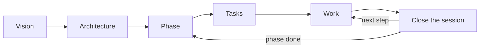

# markode

[](https://github.com/rafiqui1987/markode/actions/workflows/ci.yml)
[](LICENSE)

**See and edit every Markdown file in your project in one place: no split screen, no raw syntax in the
way.**

Run `markode` in any repository and it opens all its `.md` files (`README.md`, `CLAUDE.md`, `AGENTS.md`,
`docs/`…) in a single editor that is also the preview. Tables, Mermaid diagrams, checklists and math
render as you type, and change in place. Files are saved exactly as written, never reformatted, so Git
diffs stay clean and AI agents keep reading plain Markdown.

**Why it exists:** [write less, point better](#the-markode-philosophy).

<picture>
  <source media="(prefers-color-scheme: dark)" srcset="docs/assets/screenshot-dark.png">
  
</picture>

## Quick start

Requires Node.js 20 or newer. From the root of any project (monorepos included):

```bash
npx @rafiqui987/markode
```

The viewer is always there. The very first time, markode asks a single question: what else to install.

| Choice | What you get |
|---|---|
| **Viewer only** | See and edit every `.md` file. Nothing is written to the project. |
| **Viewer + AI agent** (recommended) | The viewer, plus the markode skill for your agent, working rules, proposals, comments, live changes and translations. |
| **Complete** | All of the above, plus the dashboard and a docs structure for vision, architecture, phases and tasks. |
| **Choose the modules** | Pick each module from the list below. |

Your choice is saved as the default for new projects (in `~/.markode/defaults.json`), so they don't ask
again. Everything else is detected: the main doc (`CLAUDE.md`, `AGENTS.md` or both), the agents the
project uses, the language its docs are written in, its projects in a monorepo, and an existing
OpenSpec or Spec Kit setup. Every module can be turned on or off later in **Settings → Features**.

| Module | What it does | What it writes |
|---|---|---|
| **AI agent** | Teaches your agent (Claude Code, Codex, Cursor, Gemini…) how to work with these docs, and lets you comment on any text for it. | `.claude/skills/markode/` and/or `.agents/skills/markode/`, a "Working rules" section in the main doc with the source language |
| **Working rules** | Rules the agent follows in this project, chosen in the Rules tab. Needs the AI agent. | Inside the "Working rules" section |
| **Proposals** | The agent answers big questions with a doc you answer by ticking options and commenting. Needs the AI agent. | `markode-proposals` skill, a "Proposals" section in the main doc |
| **Live changes** | Claude Code hears about your edits and comments while it works. Needs the AI agent. | Personal hooks in `.claude/settings.local.json` |
| **Translations** | Read and edit the docs in other languages; the agent translates them. Needs the AI agent. | Only `.markode/` (personal) |
| **Dashboard and tasks** | A Dashboard tab with the state of docs, proposals, phases and tasks; with the AI agent, also a structure for them (the markode method). | `docs/`, `markode-*` skills, a "Workflow" section in the main doc |
| **Skills** | A tab to browse and edit your agents' skills and add them to the project. | Nothing |
| **Hide in VS Code** | Hides `.markode/` from the VS Code explorer. | `.vscode/settings.json` |

Turning a module off removes only what markode added (its sections, skills and hooks); your docs,
tasks, proposals and comments stay. markode keeps its own state in `.markode/`, which ignores itself in
git (`.markode/.gitignore`), so your `.gitignore` is never touched.

Change your choice any time with `markode setup`. Then the editor opens at `http://localhost:4319`;
it only listens on `127.0.0.1`.

## The markode philosophy

**Write less, point better.**

Most `CLAUDE.md` files grow into hundreds of lines: generic advice the agent already follows, folder
listings it can read by itself, the same decision copied in three places. It costs tokens, the agent
still searches the whole repository, and nobody keeps it up to date. markode turns the docs into a
**map** and a **memory**:

- **No filler.** Write only what the code can't tell: decisions and why, hidden conventions, the state
  of the work. A doc is created when there is something real to put in it.
- **A map, not an encyclopedia.** The main doc says where things are, not what they say. Each fact
  lives in one place; everything else links to it.
- **Memory between sessions.** The work lives in task files with a status and a next step, not in a
  chat history. Tomorrow, a new session (or a teammate) picks up where you stopped.
- **Shaped like your repository.** A single app, a monorepo or a folder of repositories each get the
  structure they need, and the setup asks only what matters for yours.

```tree
CLAUDE.md                     # the map: projects, where their docs live, how to start a session
docs/                         # vision, shared decisions, phases, work across projects
service/
  CLAUDE.md                   # what this project is and its commands, nothing more
  docs/tasks/SVC-007-....md   # in-progress · next step: retry payments on timeout
front/
  docs/tasks/FRO-012-....md   # blocked · waits on SVC-007
```

Yesterday you worked in `service/` and `front/`. Today you ask the agent *"what's pending?"*
(`/markode-status`). It reads the map, scans only the task files of each project, and answers:
SVC-007 is in progress and its next step is the retry; FRO-012 is blocked on it; phase 2 has four
pending tasks; and one change in `front/` isn't covered by any task. No digging through the code, no
explaining it all again.

markode can't force an agent to follow the map, but it makes the right path the shortest one.

## What it does

### 1. Every Markdown file of the project, in one place

A file tree with every `.md` in the folder where you run it, folders first. Search, expand or collapse
all, create files and folders inline, hide what you don't need (`.markodeignore`) and delete from the
right-click menu. Resize the sidebar by dragging its edge, or hide it for more room.

### 2. Edit and view at the same time

There is no "editor | preview" split. Markdown syntax is hidden everywhere except the line you are
editing, as in Obsidian, so you read the document as it looks and still write plain Markdown.
Undo, redo and **discard** (back to how the file was when you opened it) sit next to the breadcrumb.

### 3. Formatting without remembering syntax

- **`/` commands**: type `/` at the start of a line (or `Ctrl+Space` anywhere) for a menu of headings,
  lists, checklists, tables, code blocks, diagrams, quotes, links and frontmatter. The option applies
  to the current line or the selected lines; pick with the number or the arrows, `0` or `←` goes back.
- **Selection toolbar**: select text to copy it or turn it into bold, italic, strikethrough, code or a
  link. Hover a button for its variants (`**`/`__`, `*`/`_`, `***`).

### 4. Diagrams, tables and lists that are easy to work with

- **Mermaid diagrams** (flowcharts, sequences…) render in place and follow the light or dark theme.
  ` ```tree ` blocks draw folder structures.
- **Tables**: edit cells directly. Right-click to insert or delete rows and columns; drag borders to
  resize columns (view only, the file is not changed).
- **Tables from Excel or Google Sheets**: paste a range of cells and it becomes a Markdown table.
  `Alt+H` toggles whether the first row is a header.
- **Checklists**: click to tick. After `Enter` on a task, `Ctrl+Enter` ticks the new one.
- And more: KaTeX math (`$x^2$`, `$$…$$`), footnotes on hover, local and remote images, code blocks with
  only their language label showing.

### 5. Work in your language

Most AI agents, and most teams, work best with docs in English. If English isn't easy for you, you
don't have to choose:

- Add a language to review the docs in, from **Settings → Document languages** or with
  `markode translate`: Spanish, French, Portuguese, German or Italian, or **type any other** (Japanese,
  Dutch…). Then ask your agent for **`/markode translate`** (markode has a button to copy it), and
  markode shows **every doc in that language**. Read the architecture, tick tasks, write notes and fix
  a rule, all in your language.
- The files in the repository **stay in one source language** (English by default), so the agent and
  the rest of the team keep reading one consistent version.
- Your edits are kept as a translation until you ask for `/markode translate` again. Before changing
  a source file, the agent lists what would change and applies only what you approve. The top bar
  shows how many docs are behind, and copies the command when clicked.
- Translating is always on purpose: it never happens as a side effect of other work.
- The menus are in English by default and don't depend on the docs' language: pick English, Spanish,
  French, Portuguese, German or Italian in **Settings → General**.

Example: you open `docs/tasks/T-004-login.md` in Spanish, add an acceptance criterion and tick two
others. After `/markode translate` and your OK, the English file has the new criterion and the ticks,
and the agent works from it.

### 6. A method to plan and follow the work

`markode init` offers the **markode method**, a way of organizing the project so that you and the
agent always know what is being built, how, and what comes next:

```tree
CLAUDE.md                  # short: map, commands, how to start and close a session
docs/
  tasks/T-001-....md       # one file per task: status, goal, acceptance checklist, next step, log
  vision.md                # when you define what the project is, for whom, what is out of scope
  architecture/<topic>.md  # with the first decision on that topic
  phases/02-checkout.md    # when you plan a milestone: goal, its tasks, definition of done
```



- **It starts small**: the setup creates only the task folder and its template. The agent creates the
  vision, architecture and phase docs from templates (skill `markode-method`) when there is something
  to write. A task's status lives only in its file: there is no index to keep in sync.
- **It knows what kind of project it is**, and asks only what that kind needs. When the files don't
  make it clear, it asks:

  | Kind | Detected by | Asks | Its docs |
  |---|---|---|---|
  | App | framework, `bin`, `Dockerfile`, `main.go`… | nothing | vision, architecture, phases |
  | Library | `main`/`exports` in a public package, Cargo `[lib]` | is it published? | public API and versioning, changelog |
  | Mobile | React Native, Flutter, `android/` + `ios/` | target platforms | releases and stores |
  | Data / ML | notebooks, `dvc.yaml`, `MLproject` | where the data lives, how experiments are tracked | datasets, experiment log |
  | Infrastructure | Terraform, Pulumi, Helm, Kustomize | environments | runbooks |
  | Microservices | several services + proto/OpenAPI or compose | where the contracts live | contracts as shared architecture |

  It also recognizes monorepos with workspaces, a front end and a back end without workspaces, and
  folders of repositories; and if the project already has docs, it asks which are the official ones
  and points the agent to them instead of creating new ones.
- **The main doc stays short** and points to `docs/`. If `CLAUDE.md` or `AGENTS.md` already exist,
  they are not rewritten: markode adds a "Workflow" section with the map and the session routine.
- **Each fact lives in one place**: decisions in `architecture/`, progress in the task files.
- **Sessions pick up where they stopped**: the agent looks for tasks `in-progress`, reads their "Next
  step" and tells you where you left off. `/markode-status` sums up what is in progress, blocked and
  pending, per project; `/markode-new-task` creates a task in the right place; and
  `/markode-close-session` logs what was done, the next step and the status.
- **Monorepos**: each project (`apps/web`, `services/api`… or each repository in a folder of repos)
  gets its own short `CLAUDE.md`/`AGENTS.md`, tasks with its own prefix (`WEB-001`, `API-001`),
  proposals and, with its first decision, a `docs/ARCHITECTURE.md`. The root main doc is the
  overview: a table of the projects, what each one is and where its docs live. The root `docs/` holds
  vision, phases and work across projects (`CORE-001`). The agent reads only the project it is
  working on. A project's existing `CLAUDE.md`/`AGENTS.md` is kept as is: markode only adds a short
  block pointing to its docs.
- **Every agent finds the instructions**: Claude Code reads `CLAUDE.md`; Codex, Cursor, Gemini and
  others read `AGENTS.md`. Where a folder has only one, markode offers the other, pointing to it (a
  one-line `CLAUDE.md` with `@AGENTS.md`, or an `AGENTS.md` that sends agents to `CLAUDE.md`) in the
  Dashboard and from the agent at the start of a session (`markode link`); the setup offers the
  `CLAUDE.md` one. Nothing is copied; `markode link --skip` stops the offer.
- **The Dashboard** shows each phase with its progress and tasks, and a board of what is in progress,
  blocked and pending.

**Prefer spec-driven development?** Pick one of these instead, and the Dashboard follows it too:

| Option | What you get |
|---|---|
| **[OpenSpec](https://github.com/Fission-AI/OpenSpec)** | `openspec/` with specs and proposed changes; the dashboard shows each change and its tasks |
| **[GitHub Spec Kit](https://github.com/github/spec-kit)** | a constitution and one folder per feature (spec → plan → tasks); the dashboard shows what each has |

markode runs their official installer, which also adds their commands to your agent (`/opsx:*`,
`/speckit-*`). If it can't (Spec Kit needs [uv](https://docs.astral.sh/uv/)), it creates a compatible
structure with a guide on how to add them later. Projects that already use either are detected and
shown as they are. Choose **None** and markode adds no structure or workflow at all.

### 7. Proposals and comments: answer the agent with clicks

When an answer would be long or has options to choose from (or when you ask for one), the agent writes
a **proposal** instead of a long chat message: options with small ASCII or Mermaid diagrams, choices to
tick, open questions, and the docs the decision will change. You answer in markode:

```text
 ┌ Proposal: Authentication ─────────────────────────────┐
 │  Option A (recommended)                               │
 │   Browser ──REST──▶ Gateway ──gRPC──▶ Users ──▶ (DB)  │
 │                                                       │
 │  Your choice                                          │
 │   (•) A: gateway validates                            │
 │   ( ) B: each service validates                       │
 │                                                       │
 │  [ Done, send my answer ]                             │
 └───────────────────────────────────────────────────────┘
```

- **Tick options**: a list marked `<!-- choose: one -->` behaves like radio buttons; any other
  checklist allows several.
- **Comment like in Word**: select text and press 💬. The text is highlighted and the thread shows next
  to it, with replies and a button to resolve it. In the file, a comment is an HTML comment, invisible
  on GitHub and readable by the agent:

  ```md
  - [x] A: gateway validates
    <!-- comment by Ana, 2026-10-22, on "gateway validates": What if it goes down? -->
    <!-- reply by AI, 2026-10-22: Two instances minimum; added to the architecture. -->
  ```

- **Send your answer**: the button marks the proposal as answered and copies a message to paste in your
  AI chat. The agent replies to your comments and updates every doc that depends on the decision
  (tasks, phases, architecture…). Once applied, the decision lives in those docs and the proposal is
  archived in an `applied/` folder next to it: hidden in markode (shown with "show ignored"), ignored
  by the dashboard, checks and translations, and never read by the agent unless you ask about it.
- In a monorepo, proposals are organized **by project and topic** (`apps/web/docs/proposals/auth/…`);
  in a big single project they can be organized by topic instead of one folder.

It comes with the markode method, and can be turned on or off for any project in **Settings**.

### 8. Your AI agent's skills

The **Skills** tab lists every global skill you have for Claude Code, Codex, Gemini, Copilot or Cursor
([Agent Skills](https://agentskills.io) format). Tag them to group them, expand one to read or edit its
`SKILL.md`, see problems that would stop an agent from loading it, and **add it to the current project**
(`.claude/skills/` and/or `.agents/skills/`). Tags are stored in `~/.markode/skills.json`, never in the
skill.

### 9. Also included

- **Changes**: Git diff of your Markdown, grouped by folder and section.
- **Rules**: your library of reusable rules, written into `CLAUDE.md` or `AGENTS.md` where you apply
  them. It starts with common ones for AI agents (ask before committing, verify before saying it's done,
  minimal changes, protect secrets…); edit them and add your own. The setup applies none unless you
  choose them. The library lives in `~/.markode/rules/`.
- **Settings**, by section: General (interface language, theme), Editor (font, size, line spacing,
  margins, line width, wrapping), Document languages and Proposals.

## Keyboard shortcuts

| Keys | Action |
|---|---|
| `/` at the start of a line, `Ctrl+Space` | Insert menu |
| `Ctrl+Enter` | Tick or untick the task on the current line |
| `Alt+H` | After pasting a table from a spreadsheet: toggle the header row |
| `Ctrl+Z` / `Ctrl+Y` | Undo / redo |
| `Ctrl+F` / `Ctrl+H` | Find / find and replace (box at the top right) |
| `Enter` / `Shift+Enter` | Next / previous match |
| `Alt+C` / `Alt+W` / `Alt+R` | Match case / whole word / regular expression |
| `Escape` | Close a menu or the selection toolbar |

## Commands

```bash
markode                     # set up the project if needed, then open the editor
markode init                # run the setup again: only adds modules (with your defaults, if you saved them)
markode init --profile full # no questions: viewer, agent or full
markode init --yes          # no questions: your defaults, or viewer + AI agent
markode init --custom       # choose each module and answer every question for this project
markode setup               # change your defaults, or switch to asking in each project
markode setup --custom      # also choose the main doc, language, rules and monorepo layout
markode -D                  # first run: don't save your choice as the default
markode features            # which modules are on, with what each one does
markode features live off   # turn a module on or off (same as Settings → Features)
markode serve               # open the editor without the setup
markode serve --port 5000 --no-open
markode translate           # choose languages to review the docs in (also: markode --translate)
markode link                # only CLAUDE.md or only AGENTS.md? add the other one, pointing to it
markode -v                  # version
```

To keep it installed: `npm install -g @rafiqui987/markode` (or `pnpm add -g @rafiqui987/markode`).

## For AI agents

The AI agent module installs the `markode` skill (in `.claude/skills/` for Claude Code and in
`.agents/skills/` for Codex, Copilot, Gemini and other agents, depending on which ones the project
uses). It tells the agent how to write Markdown that markode presents well, and gives it two commands.
markode refreshes the skills it installed every time the editor starts, so updating markode is enough:

| Command | What the agent does | When |
|---|---|---|
| `/markode sync` | Keeps the docs consistent: applies answered proposals, ticks phases from their tasks, checks the projects table and broken links (`markode check`) | Start and end of a session, after editing docs |
| `/markode translate` | Translates what is behind; asks before changing any source file | Only when you ask |

It also writes into the main doc:

- the working rules you picked, between `<!-- markode:rules:start -->` and `<!-- markode:rules:end -->`;
- how the project plans its work (the markode method, OpenSpec or Spec Kit), between
  `<!-- markode:workflow:start -->` and `<!-- markode:workflow:end -->`. With the markode method it
  also installs the `markode-new-task` and `markode-close-session` skills.
- with proposals on, how the agent writes proposals and answers comments (skill
  `markode-proposals`), between `<!-- markode:proposals:start -->` and `<!-- markode:proposals:end -->`.

When the agent writes a proposal, it runs `markode wait <proposal>` in the background: it waits
without using tokens until you press "Done, send my answer" in markode, then hands the agent your
choices, open questions and comments, and the agent continues by itself. If no session was open, the
next one applies the answer first.

### While the agent works

You can keep editing and commenting in markode while the agent works. markode logs what you save
(the agent's own edits go straight to disk, so they never count), and `markode changes` tells the agent
what is new since it was last told:

- a doc you edited (and which section): the agent re-reads it before working on that part;
- a comment on what it is working on: it replies below it and applies it;
- a comment on anything else: it asks you in one line whether to take it now.

Comments in a proposal still travel with its answer (`markode wait`).

**Claude Code hooks.** With the Live changes module, in projects that use Claude Code, markode adds
three hooks to `.claude/settings.local.json` (personal: each teammate decides), so the agent hears
about your edits and comments after every step, with no tokens spent while nothing changes:

```json
{
  "hooks": {
    "SessionStart": [{ "hooks": [{ "type": "command", "command": "markode changes --start" }] }],
    "UserPromptSubmit": [{ "hooks": [{ "type": "command", "command": "markode changes --hook UserPromptSubmit" }] }],
    "PostToolUse": [{ "hooks": [{ "type": "command", "command": "markode changes --hook PostToolUse" }] }]
  }
}
```

Without a global install the command is `npx -y --prefer-offline @rafiqui987/markode`; installing it
(`npm i -g @rafiqui987/markode`) makes each hook faster. Other agents run `markode changes` themselves,
as the markode skill tells them.

```bash
markode check [--json]                                # what /markode sync fixes
markode wait <proposal.md>                            # wait for the user's answer, then print it
markode changes [--json]                              # the user's edits and comments since last told
markode changes --start                               # a new session: what happened before is old news
markode translate --status [--json]                   # translations + files not in the source language
markode translate --mark [--lang xx] <path...>|--all  # record translations as in sync
markode translate --keep <path...>                    # keep files in their current language
```

## Uninstall

```bash
npm uninstall -g markode    # or: pnpm remove -g markode (use the one you installed it with)
```

To remove it from a project, turn every module off (`markode features agent off`,
`markode features dashboard off`, `markode features vscode off`) and delete `.markode/`. That removes
the skills, hooks and the `markode:*` sections it added; your docs stay. Projects set up before 0.3 may
also have a `.markode/` line in `.gitignore`. Editor settings, rule presets and skill tags live in
`~/.markode`.

## Development

```bash
pnpm install
pnpm dev        # server on :4319 (this repo as root) + Vite on http://localhost:4320
pnpm build      # web → dist/web, CLI → dist/cli.js
pnpm typecheck
```

To try your local build in other projects, run `pnpm build && pnpm add -g "link:$PWD"`.

See [docs/SPEC.md](docs/SPEC.md) for the specification and [CONTRIBUTING.md](CONTRIBUTING.md) to
contribute.

## License

[MIT](LICENSE)
