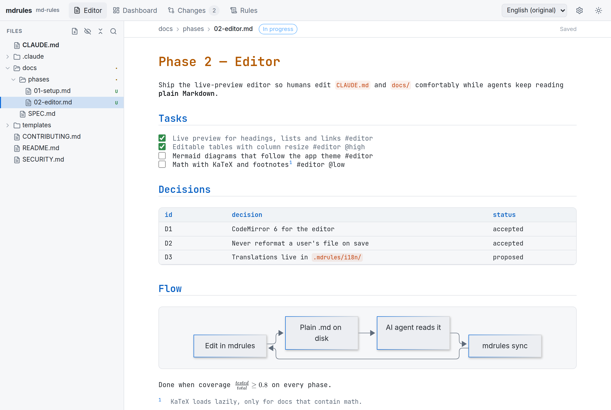

# mdrules

[](https://github.com/rafiqui1987/mdrules/actions/workflows/ci.yml)
[](LICENSE)

**mdrules** is a local, open-source editor for the Markdown that drives your project and your AI agents:
`CLAUDE.md`, `AGENTS.md` and everything under `docs/`. Run `mdrules` in any repo and get a VS Code-style
file tree with an Obsidian-style live preview: editable tables, Mermaid diagrams, KaTeX math, footnotes,
images and checklists, plus a dashboard of phases and tasks from frontmatter, git changes and reusable
rule presets. Files are saved exactly as written, never reformatted, so the AI always reads clean, plain
Markdown. Docs can also be viewed and edited in your own language while the source stays in sync.

<picture>
  <source media="(prefers-color-scheme: dark)" srcset="docs/assets/screenshot-dark.png">
  
</picture>

## Quick start

Requires Node.js 20 or newer.

```bash
# from the root of any project (monorepos included)
npx mdrules          # first run asks: main doc, docs/ structure, rules, languages
```

Or install it globally:

```bash
npm install -g mdrules      # or: pnpm add -g mdrules
mdrules                     # init if needed, then open the editor
mdrules init                # re-run the setup
mdrules serve               # open the editor without running init
mdrules serve --port 5000 --no-open
```

The editor opens at `http://localhost:4319` and only listens on `127.0.0.1`.

## Features

### Live preview editor

Markdown syntax hides where the cursor isn't and comes back where you edit, as in Obsidian.

- **Tables**: rendered and editable in place. Right-click a header to insert or delete columns, any row
  to insert or delete rows. Drag column borders to resize (view-only, stored per browser). Paste a
  range from Excel or Google Sheets to get a Markdown table; a hint offers `Alt+H` to drop the header row.
- **Diagrams and structure**: ` ```mermaid ` diagrams that follow the app theme, and ` ```tree ` blocks
  for folder layouts.
- **Math and footnotes**: `$inline$` and `$$display$$` math with KaTeX (prices like `$5` stay text),
  `[^1]` footnotes as numbered superscripts with the note on hover.
- **Images**: local paths resolve from the document's folder, as on GitHub, and remote URLs load directly.
- **Code blocks**: fences are hidden and only the language label is shown; copying still gives the full
  Markdown.
- **Selection toolbar**: select text to copy it and turn it into bold, italic, strikethrough, code or a
  link. Hover a button for its variants (`**`/`__`, `*`/`_`, `***`).
- **Checklists**: click to tick. After `Enter` on a task, `Ctrl+Enter` checks the new one.
- **Insert menu**: `/` at the start of a line opens a numbered, grouped menu with headings, lists,
  tables, code, diagrams and frontmatter.

### Workspace

- **File tree**: every `.md` in the project in a sidebar. Search, expand or collapse all, create, ignore
  (`.mdrulesignore`) and delete from the right-click menu.
- **Undo and redo** buttons appear in the sidebar once there is something to undo.
- **Dashboard** of phases and docs from frontmatter (`type`, `status`, `phase`, `updated`) with task
  progress.
- **Changes**: git diff of your Markdown, grouped by folder.
- **Rules**: reusable rule presets written into your main doc.
- **Settings**: font, size, line spacing, side margin, line width, and line wrapping (wrap, or scroll
  horizontally). Light and dark themes, following the system until you pick one.

### Languages

Each project has a source language (English by default) plus any translation languages: English, Spanish,
French, Portuguese, German and Italian. Translations live in `.mdrules/i18n/` (git-ignored). You can view
and edit docs in your language, and the AI applies your edits to the source with `/mdrules sync`. The UI
is translated too.

## AI side

`mdrules init` installs `.claude/skills/mdrules/SKILL.md` with the project's Markdown conventions and the
sync procedure. It also writes the selected working rules into the main doc, between
`<!-- mdrules:rules:start -->` and `<!-- mdrules:rules:end -->`.

```bash
mdrules sync --status [--json]                   # translations + files not in the source language
mdrules sync --mark [--lang xx] <path...>|--all  # record translations as in sync
mdrules sync --keep <path...>                    # keep files in their current language
```

## Development

```bash
pnpm install
pnpm dev        # server on :4319 (this repo as root) + Vite on http://localhost:4320
pnpm build      # web → dist/web, CLI → dist/cli.js
pnpm typecheck
```

To try your local build in other projects, run `pnpm build && pnpm add -g "link:$PWD"`.

See [docs/SPEC.md](docs/SPEC.md) for the specification and [CONTRIBUTING.md](CONTRIBUTING.md) to
contribute.

## License

[MIT](LICENSE)
