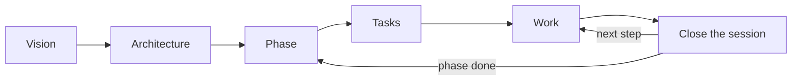

# mdrules

[](https://github.com/rafiqui1987/mdrules/actions/workflows/ci.yml)
[](LICENSE)

**See and edit every Markdown file in your project in one place: no split screen, no raw syntax in the
way.**

Run `mdrules` in any repository and it opens all its `.md` files (`README.md`, `CLAUDE.md`, `AGENTS.md`,
`docs/`…) in a single editor that is also the preview. Tables, Mermaid diagrams, checklists and math
render as you type, and change in place. Files are saved exactly as written, never reformatted, so Git
diffs stay clean and AI agents keep reading plain Markdown.

**Why it exists:** [write less, point better](#the-mdrules-philosophy).

<picture>
  <source media="(prefers-color-scheme: dark)" srcset="docs/assets/screenshot-dark.png">
  
</picture>

## Quick start

Requires Node.js 20 or newer. From the root of any project (monorepos included):

```bash
npx mdrules
```

The very first time, mdrules asks how you want your projects set up:

- **With your answers** (default): answer once (main doc, how to plan the work, the language you
  work in, rules…). They are saved in `~/.mdrules/defaults.json` and every new project is set up
  with them, without questions. For a project that needs something else: `mdrules init --custom`.
- **Ask in each project**: run `mdrules -D` the first time. Each project asks its own questions.

Change your choice any time with `mdrules setup`. Then the editor opens at `http://localhost:4319`;
it only listens on `127.0.0.1`.

## The mdrules philosophy

**Write less, point better.**

Most `CLAUDE.md` files grow into hundreds of lines: generic advice the agent already follows, folder
listings it can read by itself, the same decision copied in three places. It costs tokens, the agent
still searches the whole repository, and nobody keeps it up to date. mdrules turns the docs into a
**map** and a **memory**:

- **No filler.** Write only what the code can't tell: decisions and why, hidden conventions, the state
  of the work. A doc is created when there is something real to put in it.
- **A map, not an encyclopedia.** The main doc says where things are, not what they say. Each fact
  lives in one place; everything else links to it.
- **Memory between sessions.** The work lives in task files with a status and a next step, not in a
  chat history. Tomorrow, a new session (or a teammate) picks up where you stopped.
- **Shaped like your repository.** A single app, a monorepo or a folder of repositories each get the
  structure they need, and the setup asks only what matters for yours.

```tree
CLAUDE.md                     # the map: projects, where their docs live, how to start a session
docs/                         # vision, shared decisions, phases, work across projects
service/
  CLAUDE.md                   # what this project is and its commands, nothing more
  docs/tasks/SVC-007-....md   # in-progress · next step: retry payments on timeout
front/
  docs/tasks/FRO-012-....md   # blocked · waits on SVC-007
```

Yesterday you worked in `service/` and `front/`. Today you ask the agent *"what's pending?"*
(`/mdrules-status`). It reads the map, scans only the task files of each project, and answers:
SVC-007 is in progress and its next step is the retry; FRO-012 is blocked on it; phase 2 has four
pending tasks; and one change in `front/` isn't covered by any task. No digging through the code, no
explaining it all again.

mdrules can't force an agent to follow the map, but it makes the right path the shortest one.

## What it does

### 1. Every Markdown file of the project, in one place

A file tree with every `.md` in the folder where you run it, folders first. Search, expand or collapse
all, create files and folders inline, hide what you don't need (`.mdrulesignore`) and delete from the
right-click menu. Resize the sidebar by dragging its edge, or hide it for more room.

### 2. Edit and view at the same time

There is no "editor | preview" split. Markdown syntax is hidden everywhere except the line you are
editing, as in Obsidian, so you read the document as it looks and still write plain Markdown.
Undo, redo and **discard** (back to how the file was when you opened it) sit next to the breadcrumb.

### 3. Formatting without remembering syntax

- **`/` commands**: type `/` at the start of a line (or `Ctrl+Space` anywhere) for a menu of headings,
  lists, checklists, tables, code blocks, diagrams, quotes, links and frontmatter.
- **Selection toolbar**: select text to copy it or turn it into bold, italic, strikethrough, code or a
  link. Hover a button for its variants (`**`/`__`, `*`/`_`, `***`).

### 4. Diagrams, tables and lists that are easy to work with

- **Mermaid diagrams** (flowcharts, sequences…) render in place and follow the light or dark theme.
  ` ```tree ` blocks draw folder structures.
- **Tables**: edit cells directly. Right-click to insert or delete rows and columns; drag borders to
  resize columns (view only, the file is not changed).
- **Tables from Excel or Google Sheets**: paste a range of cells and it becomes a Markdown table.
  `Alt+H` toggles whether the first row is a header.
- **Checklists**: click to tick. After `Enter` on a task, `Ctrl+Enter` ticks the new one.
- And more: KaTeX math (`$x^2$`, `$$…$$`), footnotes on hover, local and remote images, code blocks with
  only their language label showing.

### 5. Work in your language

Most AI agents, and most teams, work best with docs in English. If English isn't easy for you, you
don't have to choose:

- Run `mdrules translate` and pick a language to review the docs in: Spanish, French, Portuguese,
  German or Italian, or **type any other** (Japanese, Dutch…). mdrules then shows **every doc in that
  language**.
- The menus are in English by default and don't depend on the docs' language: pick English, Spanish,
  French, Portuguese, German or Italian in **Settings → General**.
  Read the architecture, tick tasks, write notes and fix a rule, all in your language.
- The files in the repository **stay in one source language** (English by default), so the agent and
  the rest of the team keep reading one consistent version.
- Your edits are kept as a translation until you ask the agent for `/mdrules sync`: it applies them
  to the source file and refreshes every translation. The sidebar marks which docs are pending.

Example: you open `docs/tasks/T-004-login.md` in Spanish, add an acceptance criterion and tick two
others. After `/mdrules sync`, the English file has the new criterion and the ticks, and the agent
works from it.

### 6. A method to plan and follow the work

`mdrules init` offers the **mdrules method**, a way of organizing the project so that you and the
agent always know what is being built, how, and what comes next:

```tree
CLAUDE.md                  # short: map, commands, how to start and close a session
docs/
  tasks/T-001-....md       # one file per task: status, goal, acceptance checklist, next step, log
  vision.md                # when you define what the project is, for whom, what is out of scope
  architecture/<topic>.md  # with the first decision on that topic
  phases/02-checkout.md    # when you plan a milestone: goal, its tasks, definition of done
```



- **It starts small**: the setup creates only the task folder and its template. The agent creates the
  vision, architecture and phase docs from templates (skill `mdrules-method`) when there is something
  to write. A task's status lives only in its file: there is no index to keep in sync.
- **It knows what kind of project it is**, and asks only what that kind needs. When the files don't
  make it clear, it asks:

  | Kind | Detected by | Asks | Its docs |
  |---|---|---|---|
  | App | framework, `bin`, `Dockerfile`, `main.go`… | nothing | vision, architecture, phases |
  | Library | `main`/`exports` in a public package, Cargo `[lib]` | is it published? | public API and versioning, changelog |
  | Mobile | React Native, Flutter, `android/` + `ios/` | target platforms | releases and stores |
  | Data / ML | notebooks, `dvc.yaml`, `MLproject` | where the data lives, how experiments are tracked | datasets, experiment log |
  | Infrastructure | Terraform, Pulumi, Helm, Kustomize | environments | runbooks |
  | Microservices | several services + proto/OpenAPI or compose | where the contracts live | contracts as shared architecture |

  It also recognizes monorepos with workspaces, a front end and a back end without workspaces, and
  folders of repositories; and if the project already has docs, it asks which are the official ones
  and points the agent to them instead of creating new ones.
- **The main doc stays short** and points to `docs/`. If `CLAUDE.md` or `AGENTS.md` already exist,
  they are not rewritten: mdrules adds a "Workflow" section with the map and the session routine.
- **Each fact lives in one place**: decisions in `architecture/`, progress in the task files.
- **Sessions pick up where they stopped**: the agent looks for tasks `in-progress`, reads their "Next
  step" and tells you where you left off. `/mdrules-status` sums up what is in progress, blocked and
  pending, per project; `/mdrules-new-task` creates a task in the right place; and
  `/mdrules-close-session` logs what was done, the next step and the status.
- **Monorepos**: each project (`apps/web`, `services/api`… or each repository in a folder of repos)
  gets its own short `CLAUDE.md`/`AGENTS.md`, tasks with its own prefix (`WEB-001`, `API-001`),
  proposals and, with its first decision, a `docs/ARCHITECTURE.md`. The root main doc is the
  overview: a table of the projects, what each one is and where its docs live. The root `docs/` holds
  vision, phases and work across projects (`CORE-001`). The agent reads only the project it is
  working on. A project's existing `CLAUDE.md`/`AGENTS.md` is kept as is: mdrules only adds a short
  block pointing to its docs. Where there is only `AGENTS.md` and you use Claude Code, it adds a
  one-line `CLAUDE.md` that imports it (`@AGENTS.md`), since Claude Code reads `CLAUDE.md`.
- **The Dashboard** shows each phase with its progress and tasks, and a board of what is in progress,
  blocked and pending.

**Prefer spec-driven development?** Pick one of these instead, and the Dashboard follows it too:

| Option | What you get |
|---|---|
| **[OpenSpec](https://github.com/Fission-AI/OpenSpec)** | `openspec/` with specs and proposed changes; the dashboard shows each change and its tasks |
| **[GitHub Spec Kit](https://github.com/github/spec-kit)** | a constitution and one folder per feature (spec → plan → tasks); the dashboard shows what each has |

mdrules runs their official installer, which also adds their commands to your agent (`/opsx:*`,
`/speckit-*`). If it can't (Spec Kit needs [uv](https://docs.astral.sh/uv/)), it creates a compatible
structure with a guide on how to add them later. Projects that already use either are detected and
shown as they are. Choose **None** and mdrules adds no structure or workflow at all.

### 7. Proposals and comments: answer the AI with clicks

When an answer would be long or has options to choose from (or when you ask for one), the agent writes
a **proposal** instead of a long chat message: options with small ASCII or Mermaid diagrams, choices to
tick, open questions, and the docs the decision will change. You answer in mdrules:

```text
 ┌ Proposal: Authentication ─────────────────────────────┐
 │  Option A (recommended)                               │
 │   Browser ──REST──▶ Gateway ──gRPC──▶ Users ──▶ (DB)  │
 │                                                       │
 │  Your choice                                          │
 │   (•) A: gateway validates                            │
 │   ( ) B: each service validates                       │
 │                                                       │
 │  [ Done, send my answer ]                             │
 └───────────────────────────────────────────────────────┘
```

- **Tick options**: a list marked `<!-- choose: one -->` behaves like radio buttons; any other
  checklist allows several.
- **Comment like in Word**: select text and press 💬. The text is highlighted and the thread shows next
  to it, with replies and a button to resolve it. In the file, a comment is an HTML comment, invisible
  on GitHub and readable by the agent:

  ```md
  - [x] A: gateway validates
    <!-- comment by Ana, 2026-10-22, on "gateway validates": What if it goes down? -->
    <!-- reply by AI, 2026-10-22: Two instances minimum; added to the architecture. -->
  ```

- **Send your answer**: the button marks the proposal as answered and copies a message to paste in your
  AI chat. The agent replies to your comments and updates every doc that depends on the decision
  (tasks, phases, architecture…). A proposal is temporary: once applied, it is deleted and the decision
  lives in those docs.
- In a monorepo, proposals are organized **by project and topic** (`apps/web/docs/proposals/auth/…`);
  in a big single project they can be organized by topic instead of one folder.

It comes with the mdrules method, and can be turned on or off for any project in **Settings**.

### 8. Your AI agent's skills

The **Skills** tab lists every global skill you have for Claude Code, Codex, Gemini, Copilot or Cursor
([Agent Skills](https://agentskills.io) format). Tag them to group them, expand one to read or edit its
`SKILL.md`, see problems that would stop an agent from loading it, and **add it to the current project**
(`.claude/skills/` and/or `.agents/skills/`). Tags are stored in `~/.mdrules/skills.json`, never in the
skill.

### 9. Also included

- **Changes**: Git diff of your Markdown, grouped by folder and section.
- **Rules**: your library of reusable rules, written into `CLAUDE.md` or `AGENTS.md` where you apply
  them. It starts with common ones for AI agents (ask before committing, verify before saying it's done,
  minimal changes, protect secrets…); edit them and add your own. The setup applies none unless you
  choose them. The library lives in `~/.mdrules/rules/`.
- **Settings**, by section: General (interface language, theme), Editor (font, size, line spacing,
  margins, line width, wrapping), Document languages and Proposals.

## Keyboard shortcuts

| Keys | Action |
|---|---|
| `/` at the start of a line, `Ctrl+Space` | Insert menu |
| `Ctrl+Enter` | Tick or untick the task on the current line |
| `Alt+H` | After pasting a table from a spreadsheet: toggle the header row |
| `Ctrl+Z` / `Ctrl+Y` | Undo / redo |
| `Ctrl+F` / `Ctrl+H` | Find / find and replace (box at the top right) |
| `Enter` / `Shift+Enter` | Next / previous match |
| `Alt+C` / `Alt+W` / `Alt+R` | Match case / whole word / regular expression |
| `Escape` | Close a menu or the selection toolbar |

## Commands

```bash
mdrules                     # set up the project if needed, then open the editor
mdrules init                # run the setup again (with your defaults, if you saved them)
mdrules init --custom       # set up this project with its own answers
mdrules setup               # change your defaults, or switch to asking in each project
mdrules -D                  # first run: don't save defaults, ask in each project
mdrules serve               # open the editor without the setup
mdrules serve --port 5000 --no-open
mdrules translate           # choose languages to review the docs in (also: mdrules --translate)
```

To keep it installed: `npm install -g mdrules` (or `pnpm add -g mdrules`).

## For AI agents

`mdrules init` installs `.claude/skills/mdrules/SKILL.md`, which tells the agent how to write Markdown
that mdrules presents well and how to keep translations in sync. It also writes into the main doc:

- the working rules you picked, between `<!-- mdrules:rules:start -->` and `<!-- mdrules:rules:end -->`;
- how the project plans its work (the mdrules method, OpenSpec or Spec Kit), between
  `<!-- mdrules:workflow:start -->` and `<!-- mdrules:workflow:end -->`. With the mdrules method it
  also installs the `mdrules-new-task` and `mdrules-close-session` skills.
- with proposals on, how the agent writes proposals and answers comments (skill
  `mdrules-proposals`), between `<!-- mdrules:proposals:start -->` and `<!-- mdrules:proposals:end -->`.

```bash
mdrules sync --status [--json]                   # translations + files not in the source language
mdrules sync --mark [--lang xx] <path...>|--all  # record translations as in sync
mdrules sync --keep <path...>                    # keep files in their current language
```

## Uninstall

```bash
npm uninstall -g mdrules    # or: pnpm remove -g mdrules (use the one you installed it with)
```

To remove it from a project, delete `.mdrules/` and `.claude/skills/mdrules*/`, the `.mdrules/` line in
`.gitignore`, and the `mdrules:rules`, `mdrules:workflow` and `mdrules:proposals` blocks in your main doc (keep the text
inside if you still want it). Editor settings, rule presets and skill tags live in `~/.mdrules`.

## Development

```bash
pnpm install
pnpm dev        # server on :4319 (this repo as root) + Vite on http://localhost:4320
pnpm build      # web → dist/web, CLI → dist/cli.js
pnpm typecheck
```

To try your local build in other projects, run `pnpm build && pnpm add -g "link:$PWD"`.

See [docs/SPEC.md](docs/SPEC.md) for the specification and [CONTRIBUTING.md](CONTRIBUTING.md) to
contribute.

## License

[MIT](LICENSE)
