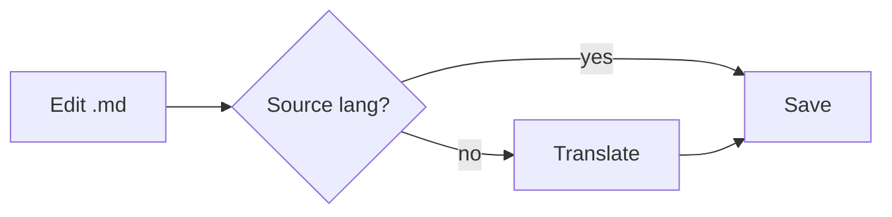
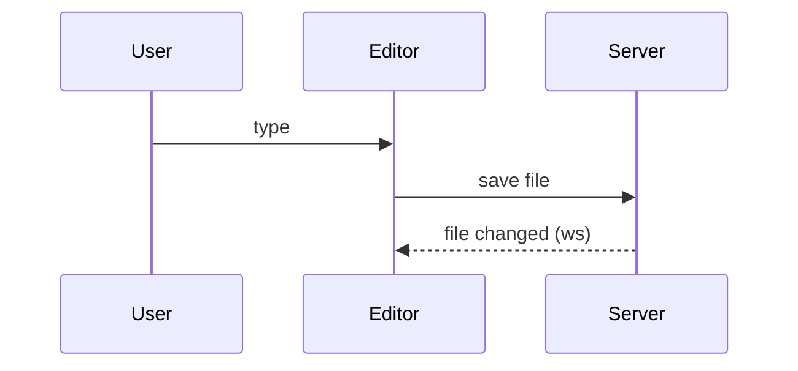
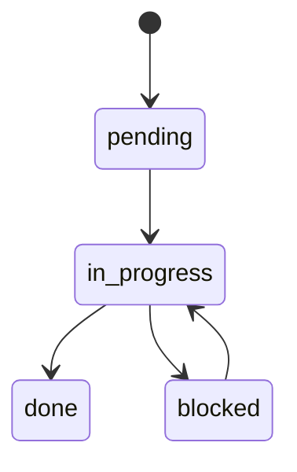
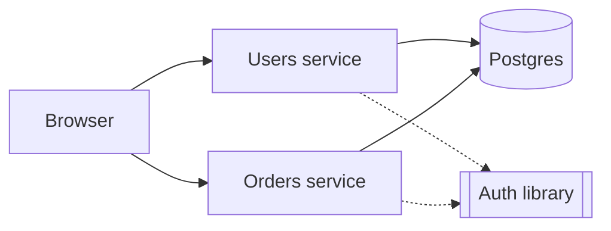

 # Markdown feature showcase

A single document that exercises every Markdown feature, for testing the editor's live preview.

## Headings

# Heading 1
## Heading 2
### Heading 3
#### Heading 4
##### Heading 5
###### Heading 6

Setext heading 1
================

Setext heading 2
----------------

## Inline formatting

Plain text with **bold**, __bold alt__, *italic*, _italic alt_, ***bold italic***, ~~strikethrough~~, `inline code`, and a line with **bold containing `code` and *italic***.

Escaped characters: \*not italic\*, \`not code\`, \# not a heading, \| pipe.

HTML inline: <kbd>Ctrl</kbd> + <kbd>S</kbd>, H<sub>2</sub>O, x<sup>2</sup>, <mark>highlighted</mark>, <u>underlined</u>.

Emoji shortcode :rocket: and literal emoji 🚀.

This line ends with two spaces for a hard break  
and continues here. This one uses a backslash\
and continues too.

## Links and images

- Inline link: [markode spec](../SPEC.md)
- Link with title: [Anthropic](https://www.anthropic.com "Anthropic homepage")
- Autolink: <https://example.com> and bare URL https://example.com
- Email autolink: <hello@example.com>
- Reference link: [CommonMark][commonmark] and collapsed [GFM][]
- Heading anchor: [jump to Tables](#tables)

Image: 

Linked image: [](https://commonmark.org)

[commonmark]: https://commonmark.org "CommonMark"
[GFM]: https://github.github.com/gfm/

## Lists

Unordered:

- Item one
- Item two
  - Nested item
    - Deeper nested item
- Item three
* Asterisk bullet
+ Plus bullet

Ordered:

1. First
2. Second
   1. Nested first
   2. Nested second
3. Third

Ordered starting at 5:

5. Five
6. Six

List item with multiple paragraphs:

1. First paragraph of the item.

   Second paragraph, indented to belong to the same item.

   ```bash
   echo "code inside a list item"
   ```

2. Next item.

## Task lists

- [x] Scan project Markdown #core @high
- [x] Live preview for headings #editor
- [ ] Table widget editing #editor @medium
- [ ] Mermaid rendering in dark mode #editor @low
  - [x] Nested done subtask
  - [ ] Nested pending subtask
    - [ ] fsdnfjd
    - [x] jwernjwerj
  - [ ] dfsdfd
  - [ ] 

## Blockquotes

> A simple blockquote.
>
> With a second paragraph and **formatting**.
>
> > A nested blockquote.

> [!NOTE]
> GitHub-style alert: useful information.

> [!TIP]
> Helpful advice.

> [!IMPORTANT]
> Key information.

> [!WARNING]
> Urgent info that needs attention.

> [!CAUTION]
> Negative potential consequences.

## Code

Indented code block:

    const indented = true

Fenced with language:

```ts
interface Rule {
  id: string
  enabled: boolean
}

export function active(rules: Rule[]): Rule[] {
  return rules.filter((r) => r.enabled)
}
```

```json
{ "name": "markode", "private": true }
```

```diff
- removed line
+ added line
```

Tilde fence without language:

~~~
plain fenced block
~~~

## Tables

| id  | rule                    | severity | enabled |
| --- | :---------------------- | :------: | ------: |
| R1  | Use pnpm only           | high     | yes     |
| R2  | English for `.md` files | medium   | yes     |
| R3  | Escaped \| pipe in cell | low      | no      |
| R4  | **Bold** and [link](#)  | low      | yes     |

## Tree

```tree
src/
  cli/         # entry and interactive init
  core/        # scan, i18n, presets, git
    scan.ts    # finds Markdown files
  server/      # http API + websocket watcher
web/
  src/
    editor/    # CodeMirror live preview
```

## Mermaid







## Math

Inline math: $E = mc^2$.

$$
\sum_{i=1}^{n} i = \frac{n(n+1)}{2}
$$

## Footnotes

Markdown has footnotes[^1] and named footnotes[^note].

[^1]: This is the first footnote.
[^note]: A named footnote with **formatting**.

## Horizontal rules

---

***

___

## HTML blocks

<details>
<summary>Click to expand</summary>

Hidden content with **Markdown** inside.

</details>

<div align="center">
  <strong>Centered HTML block</strong>
</div>

## Comments and markers

A note on its own line (hidden when rendered, read by agents):

<!-- A regular HTML comment: invisible in rendered output. -->

A note inside a sentence <!-- shown as a small icon --> keeps the text flowing.

<!--
A note over several lines,
for longer explanations.
-->

A marker a tool reads, as a language chip <!-- markode:source-lang:en --> and as a tag <!-- rule:example-rule -->.

A region a tool manages:

<!-- markode:example:start -->
Content between custom markers.
<!-- markode:example:end -->

Comment threads and `<!-- choose: one -->` are shown in the Proposal section below.


## Definition-like and misc

Term
: Definition (extended syntax, not GFM).

Abbreviation: *[HTML]: Hyper Text Markup Language

Line with trailing hashtag style tags #docs #example and a mention @rafael.

## Proposal

An example of what the agent writes when there is a choice to make. In a real proposal this is its own
file with `type: proposal` in the frontmatter, which adds the "send my answer" banner.

### Option A: the gateway validates every request (recommended)

```text
                 ┌─────────────┐   gRPC   ┌───────────────┐
 Browser ──REST─▶│   Gateway   │─────────▶│ Users service │──▶ (Postgres)
                 │ token+authz │          └───────────────┘
                 └──────┬──────┘
                        │ check
                        ▼
                   ┌─────────┐
                   │ OpenFGA │
                   └─────────┘
```

- One place checks every request; services stay simple.
- The gateway must run at least two instances.

### Option B: each service validates its own tokens



- No single point of failure.
- The same auth code is repeated in every service.

### Your choice

<!-- choose: one -->
- [x] A: the gateway validates every request
  <!-- comment by Rafael, 2026-10-22, on "the gateway validates": What happens if the gateway goes down? -->
  <!-- reply by AI, 2026-10-22: Cloud Run keeps two instances minimum, so one can fail without downtime. -->
- [x] B: each service validates its own tokens

### Also include

- [x] Login by email code
- [ ] Login by magic link
- [x] Remember the device for 14 days

### Open questions

1. How many sessions can a person have at once?

   <!-- choose: one -->
   - [ ] One: signing in elsewhere closes the other session
   - [x] Several, with a list to close them

2. Anything else?

   Write here, or select any text above and press the comment button.
