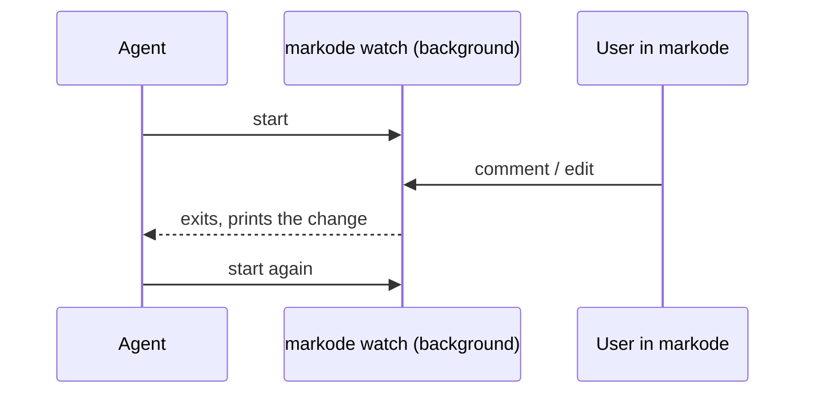

# Proposal: the agent notices doc edits and comments while it works

## Context

While an agent works, the user keeps editing docs and leaving comments in markode. Today the agent only
learns about comments when a proposal is answered (`markode wait`), and nothing tells it about other edits
or about comments outside proposals. It has to be agent-agnostic: Claude Code, Codex, Cursor, Gemini…

What should happen, whatever the mechanism:

| The user… | The agent… |
|---|---|
| edits a doc | notes it; re-reads that doc when it works on that part of the project, not before |
| comments on what the agent is working on (same doc, section or task) | takes it into the session: replies below the comment and applies it |
| comments on something else | asks in one line ("there's a comment on X about Y: take it now or leave it?"), then replies in the file |

All options share one core command, so any agent can use it:

```text
markode changes [--new] [--json]
  Docs edited by the user  docs/architecture/auth.md (section "Tokens")
  Comments without reply   docs/tasks/T-004-login.md › "Acceptance": "What about SSO?"   (task T-004)
```

`--new` prints only what wasn't reported yet (markode remembers what it already showed), so it can be run
often and stays silent when nothing changed.

## Option A: core command + Claude Code hooks (recommended)

```text
 user edits / comments in markode
            │
            ▼
   .markode/ (what was already reported)
            │        Claude Code, after every tool call and every prompt:
            └──────▶ hook runs `markode changes --new` ──▶ prints only news ──▶ agent sees it mid-task
                     other agents: the skill says to run `markode changes` at the start and between steps
```

- In Claude Code it is deterministic: a `PostToolUse` + `UserPromptSubmit` hook runs the command, so the
  agent learns about a comment within one step, without remembering to check and without extra turns.
- Silent when nothing changed: a hook that prints nothing adds nothing to the context.
- `markode init` adds the hook to `.claude/settings.json` when the project uses Claude Code.
- Other agents get the same behavior through the skill, with less immediacy.

## Option B: background watcher the agent restarts



- Same pattern as `markode wait`; no settings to install.
- Depends on the agent restarting the watcher every time; if it forgets, it goes blind.
- Each event costs a turn, even for edits it should only note.

## Option C: only check at the start and on `/markode sync`

- Simplest: just a rule in the skill.
- Nothing is noticed while the agent works; comments wait until the next session or sync.

## Your choice

<!-- choose: one -->
- [x] A: core command + Claude Code hooks
- [ ] B: background watcher the agent restarts
- [ ] C: only at the start and on `/markode sync`

## After your answer

- A: add `markode changes` (`src/core/changes.ts`, CLI), the hook setup in `markode init` for Claude Code,
  and the rules above to the base skill; the proposals skill points to it for comments outside proposals.
- B: add `markode changes` and `markode watch`, and the rules plus "keep the watcher running" to the skill.
- C: add `markode changes` and the rules to the skill, run at session start and in `/markode sync`.
- In every case: document it in `docs/SPEC.md`.

## Open questions

1. Which comments should the agent hear about?

   <!-- choose: one -->
   - [x] Only new ones since the session started (recommended: old ones come up in `/markode sync`)
   - [ ] Every comment without a reply, in any doc

2. Which edits should it note?

   <!-- choose: one -->
   - [x] Any doc the user edited (recommended: it only acts when it works on that part)
   - [ ] Only docs the agent already read in this session

3. Should `markode init` install the Claude Code hook on its own?

   <!-- choose: one -->
   - [x] Ask during setup, yes by default (recommended)
   - [ ] Always install it
   - [ ] Never: the user adds it by hand
