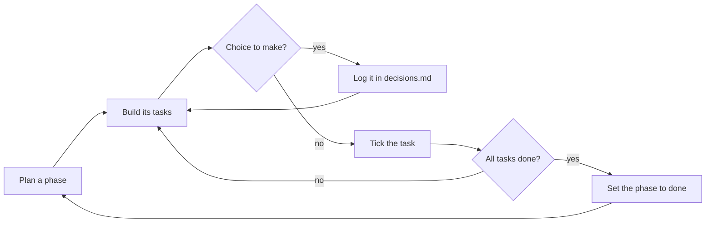

# How these docs work

This folder is the project's plan and memory. You and the AI agent both read and update it, so a new
session can pick up exactly where the last one stopped.

| File | What goes in it | Update it when |
|---|---|---|
| `architecture.md` | How the system is built: structure, components, data flow | the design changes |
| `phases/NN-name.md` | One milestone: its goal, scope, tasks and definition of done | a phase is planned, progresses or ends |
| `tasks.md` | Small, ongoing work that doesn't belong to a phase | you pick up or finish something |
| `decisions.md` | Why things are the way they are | you choose between alternatives |
| `rules.md` | Conventions everyone (and the AI) must follow | a rule is agreed |

## The loop



1. **Plan**: create `phases/NN-name.md` from the example in `phases/`. Write the goal and the definition
   of done first; tasks come after.
2. **Build**: work through the tasks. Tick each one when it is done, not before.
3. **Decide**: when you pick one option over another, add a row to `decisions.md` with the reason.
4. **Close**: when every task is ticked and the definition of done holds, set the phase to `status: done`.

## Frontmatter

Every doc starts with a small header that the mdrules dashboard reads:

```yaml
---
type: phase          # phase | tasks | rules | architecture | decision | note
status: in-progress  # pending | in-progress | done | blocked
phase: 2             # only for phases: their order
updated: 2026-01-31
---
```

## Asking the AI

- "Plan phase 2 in `docs/phases/` from what we discussed."
- "Work on the next unticked task of phase 1 and tick it when the tests pass."
- "Log the decision to use SQLite in `docs/decisions.md`."
- "Update `docs/architecture.md` with the new queue worker."
