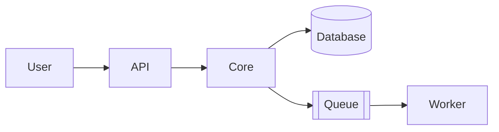
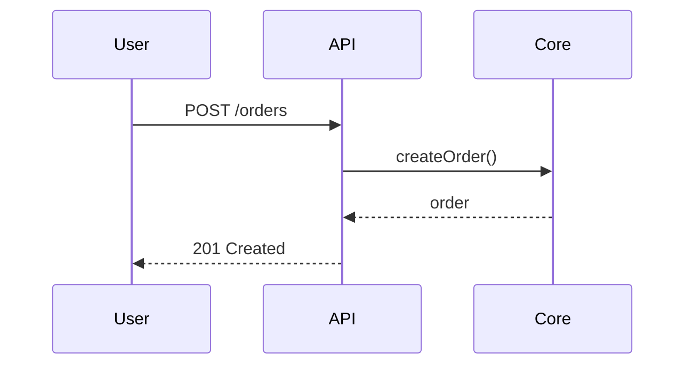

# Architecture

## Overview

<!-- Two or three sentences: what the system does and its main parts. -->

## Structure

```tree
src/
  api/        # HTTP handlers, one file per resource
  core/       # business logic, no I/O
  db/         # schema, migrations and queries
tests/        # mirrors src/
```

## Components

| id | component | responsibility | talks to |
|---|---|---|---|
| C1 | API | validates requests and calls core | Core |
| C2 | Core | business rules | DB |
| C3 | DB | persistence | |

## Data flow



## Key sequence



## External services

| id | service | used for | config |
|---|---|---|---|
| E1 | | | |
