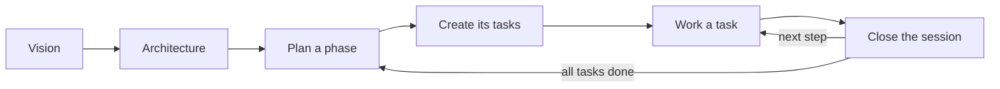

# How we work: the mdrules method

These docs are the project's plan and memory. You and the AI agent read and update them, so any
session (yours or the agent's) can pick up exactly where the last one stopped. The main doc
(`CLAUDE.md` or `AGENTS.md`) stays short and points here.

## Where things live

| What | Where | Holds |
|---|---|---|
| Vision | `docs/vision.md` | What the project is, for whom, and what is out of scope |
| Architecture | `docs/architecture/` | Technology and design decisions, one file per topic; `README.md` is the index |
| Phases | `docs/phases/NN-name.md` | Construction milestones: goal, the tasks that build it, definition of done |
| Tasks | `docs/tasks/<ID>-name.md` | One file per task: goal, acceptance checklist, next step, log |
| Task index | `docs/TASKS.md` | One line per task, grouped by status |

In a monorepo, each area (e.g. `services/`) has the same `docs/ARCHITECTURE.md`, `docs/TASKS.md` and
`docs/tasks/` for its own work, and its own short `CLAUDE.md`. The root `docs/` holds what crosses
areas.

## The cycle

1. **Vision and architecture first**: write what you are building and the technology choices, as
   tables of `Topic | Decision`. Change a decision in its one place when it changes.
2. **Plan a phase**: copy `phases/01-foundations.md`. Write the goal and the definition of done, then
   list its tasks.
3. **One task, one file**: ask the agent for `/mdrules-new-task`. It copies `tasks/_TEMPLATE.md`, gives
   it the next ID, and adds it to `TASKS.md` and to its phase.
4. **Work**: tick acceptance criteria as they are met. Keep "Next step" current.
5. **Close the session**: ask for `/mdrules-close-session`. The agent logs what was done, rewrites the
   next step, updates the status, and ticks the task in its phase when it is done.

## Task statuses

| status | meaning |
|---|---|
| `pending` | defined, not started |
| `in-progress` | being worked on; a new session resumes from its "Next step" |
| `blocked` | waiting on something; "Next step" says what |
| `done` | every acceptance criterion is met |

## Rules that keep it useful

- **Each fact lives in one place**; everything else links to it.
- The main doc holds orientation, rules and commands only: never decisions or task lists.
- Read only what the current task needs: its file, its area's docs and the architecture file that
  applies.

## In mdrules

The **Dashboard** shows each phase with its progress and tasks, and a board of what is in progress,
blocked and pending. Tick checklists by clicking them. If you enabled a translation language, read and
edit everything in it; the files stay in the project's source language.
