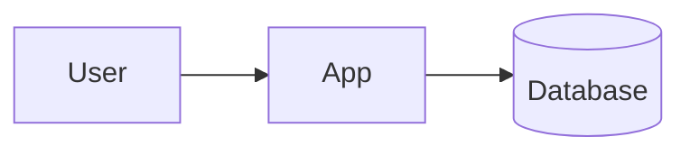

# Stack

| Topic | Decision | Why |
|---|---|---|
| Language | <!-- e.g. TypeScript --> | |
| Framework | | |
| Database | | |
| Hosting | | |
| Package manager | | |

## Structure

```tree
src/
  # main folders and what each holds
```

## Flow


