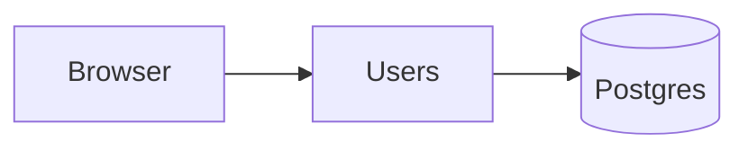

# Proposals (markode)

A proposal is a **temporary** file for one decision. Write one instead of a chat answer when:

- the answer would be long, or has several options, diagrams or a design to validate; or
- the user asks for a proposal.

For a short answer or a single obvious option, just answer in the chat.

After writing the file:

1. If a task waits on this decision, set it to `status: blocked` with "Next step: waiting on proposal
   <path>".
2. Start `markode wait <path>` **in the background** (in Claude Code, a background Bash command: you are
   notified when it exits). It waits, without using tokens, until the user presses "Done, send my
   answer" in markode, then prints their answer: choices, open questions, comments waiting for a reply,
   affected docs and your "After your answer" list. If you can't run background commands, skip it: the
   user will tell you, or the next `/markode sync` finds the answered proposal.
3. Tell the user the path in one line and that you will continue when they answer. Meanwhile, keep
   working on anything that doesn't depend on the decision.

When the watcher's output arrives, go straight to "When the user answers". Once applied, the decision
lives in the docs it affects and the proposal is archived.

**Archived proposals**: an applied proposal moves to an `applied/` folder next to it (e.g.
`docs/proposals/applied/`). It is kept only for the user to look back at: never read, search or cite
anything in an `applied/` folder of proposals, and don't treat it as current, unless the user asks
about a past proposal. markode hides it too.

## Where

{{where}}.

## Format

````md
---
type: proposal
status: open          # open → answered (set by the user in markode) → applied (archived)
updated: YYYY-MM-DD
affects: [docs/tasks/T-004-login.md, docs/architecture/auth.md]   # docs the decision will change
---

# Proposal: <topic>

## Context

<!-- Two or three lines: what needs deciding and why now. -->

## Option A: <name> (recommended)

```text
 Browser ──REST──▶ Gateway ──gRPC──▶ Users ──▶ (Postgres)
```

What it means, pros and cons in a few bullets.

## Option B: <name>



## Your choice

<!-- choose: one -->
- [ ] A: <name>
- [ ] B: <name>

## Also include

- [ ] <optional extra the user can tick>

## After your answer

- <what you will do with each possible choice, so any session can continue from here>

## Open questions

1. <question>

   <!-- choose: one -->
   - [ ] <answer>
   - [ ] <answer>
````

- Diagrams: a ` ```text ` block with box-drawing characters for small sketches, ` ```mermaid ` for
  flows and sequences. markode renders both.
- In ASCII diagrams use only single-width characters (box drawing `┌─┐│└┘▶`, letters, `#`, `-`); shading
  blocks like `▓░` are wider in many fonts and break the alignment.
- `<!-- choose: one -->` right before a checklist makes it single choice in markode (radio buttons);
  without it, any number can be ticked.
- Put your recommendation first and say why.

## Comments

The user comments like in Word. A comment is an HTML comment right after the block it refers to,
indented like that block (inside a list item: aligned with the item's text):

```md
- [x] A: gateway validates
  <!-- comment by Rafael, 2026-10-22, on "gateway validates": What if the gateway goes down? -->
```

Answer each comment with a reply right below it (or below the last reply), same indentation:

```md
  <!-- reply by AI, 2026-10-22: Two Cloud Run instances minimum; added to the architecture. -->
```

Never delete or rewrite the user's comments: they resolve them in markode. Never put `-->` inside a
comment's text. Comments in other docs reach you while you work (`markode changes`, see the markode
skill).

- `affects`: the docs that depend on this decision (tasks, phases, architecture, vision, other
  proposals…), so the user sees what their choice will change.

## When the user answers

1. Read the ticked options, the open questions and every comment without a reply from you.
2. If something is unclear or a comment raises a new question, reply to that comment, set
   `status: open` again, tell the user what you need, and start `markode wait` again. Don't apply
   anything yet.
3. Otherwise apply the decision to every doc that depends on it: the ones in `affects` and any other
   you find (a task's goal or acceptance criteria, a phase's task list, an architecture table, the
   vision…). Record it in its one place: in the markode method, the architecture file for design
   decisions, and a line in the log of the task it belongs to (`<date>: decided <what> (proposal
   <name>)`).
4. Archive the proposal: set `status: applied` and `updated`, and move the file to the `applied/` folder
   next to it (create it if needed; keep the file name). The decision now lives in those docs. A task
   that was `blocked` on it goes back to `in-progress`, with its next step from your "After your
   answer" list.
5. Tell the user in a few lines what you changed and where, then continue with that task.
