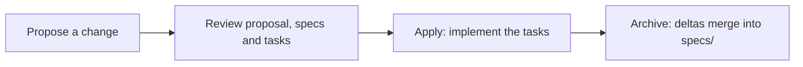

# OpenSpec guide

This project uses [OpenSpec](https://github.com/Fission-AI/OpenSpec): agree on **what** to build in
Markdown before writing code, so you and the AI work from the same spec.

## Structure

```tree
openspec/
  config.yaml          # project context and rules for the AI (edit in your code editor)
  specs/               # how the system behaves TODAY, one folder per domain
    auth/
      spec.md
  changes/             # proposed work, one folder per change
    add-2fa/
      proposal.md      # why and what
      design.md        # how (optional, for non-trivial changes)
      tasks.md         # checklist the AI works through
      specs/auth/spec.md   # delta: requirements added, modified or removed
    archive/           # finished changes, dated
```

## Lifecycle



| Step | Command (if OpenSpec is installed) | Or ask the AI |
|---|---|---|
| Explore an idea | `/opsx:explore` | "Let's think through X before proposing anything." |
| Propose | `/opsx:propose add 2FA` | "Create an OpenSpec change `add-2fa` with proposal, tasks and spec deltas." |
| Implement | `/opsx:apply` | "Implement the tasks of `add-2fa`, ticking each one." |
| Finish | `/opsx:archive` | "Archive `add-2fa` and merge its deltas into `openspec/specs/`." |

## Examples

**`changes/add-2fa/proposal.md`**

```md
# Proposal: Add two-factor authentication

## Why
Accounts are protected by a password only.

## What changes
- Users can enable TOTP codes from their settings.
- Login asks for the code when 2FA is enabled.

## Out of scope
- SMS codes.
```

**`changes/add-2fa/specs/auth/spec.md`** (delta)

```md
## ADDED Requirements

### Requirement: Two-factor login
The system SHALL ask for a one-time code after the password when 2FA is enabled.

#### Scenario: Valid code
- **WHEN** the user enters a valid code
- **THEN** they are logged in
```

**`changes/add-2fa/tasks.md`**

```md
## 1. Backend
- [ ] 1.1 Store the TOTP secret per user
- [ ] 1.2 Verify codes on login

## 2. Frontend
- [ ] 2.1 Settings screen to enable 2FA
```

## Installing OpenSpec

The `/opsx:*` commands come from the OpenSpec CLI. If they are missing, install it (needs Node.js) and
run its setup here; it keeps the files you already have:

```bash
npm install -g @fission-ai/openspec
openspec init
```
