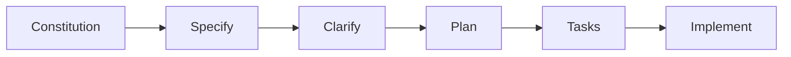

# Spec Kit guide

This project uses [GitHub Spec Kit](https://github.com/github/spec-kit): every feature goes from an
idea to a spec, a plan and a task list before any code is written.

## Structure

```tree
.specify/
  memory/constitution.md   # principles every feature must respect
  templates/               # templates the commands fill (installed by Spec Kit)
specs/
  001-user-login/          # one folder per feature, numbered
    spec.md                # what and why: user stories, requirements
    plan.md                # how: stack, architecture, data model
    tasks.md               # ordered checklist, by user story
    research.md            # optional: findings behind the plan
    data-model.md          # optional
    contracts/             # optional: API definitions
```

## Flow



| Step | Command (if Spec Kit is installed) | Or ask the AI |
|---|---|---|
| Principles | `/speckit-constitution` | "Fill `.specify/memory/constitution.md` with our principles." |
| Spec | `/speckit-specify users can log in with email` | "Write `specs/001-user-login/spec.md`: user stories, requirements, success criteria. No tech choices." |
| Clarify (optional) | `/speckit-clarify` | "Ask me about anything ambiguous in the spec." |
| Plan | `/speckit-plan use Next.js and Postgres` | "Write `plan.md` for 001 with the stack and data model." |
| Tasks | `/speckit-tasks` | "Break the plan into `tasks.md`, grouped by user story." |
| Build | `/speckit-implement` | "Implement the tasks of 001 in order, ticking each one." |

## Examples

**`specs/001-user-login/spec.md`**

```md
# Feature Specification: User login

## User Scenarios

### User Story 1 - Log in with email (Priority: P1)
A registered user logs in with email and password to reach their dashboard.

**Acceptance Scenarios**:
1. **Given** a registered user, **When** they enter valid credentials, **Then** they see their dashboard.
2. **Given** a wrong password, **When** they submit, **Then** they see an error and stay logged out.

## Requirements
- **FR-001**: The system MUST lock an account after 5 failed attempts.

## Success Criteria
- **SC-001**: 95% of logins complete in under 2 seconds.
```

**`specs/001-user-login/tasks.md`**

```md
## Phase 1: User Story 1 - Log in with email (P1)
- [ ] T001 [US1] Create the users table in src/db/schema.ts
- [ ] T002 [P] [US1] Login form in src/app/login/page.tsx
- [ ] T003 [US1] POST /api/login in src/app/api/login/route.ts
```

`[P]` marks tasks that can run in parallel.

## Installing Spec Kit

The `/speckit-*` commands come from the Spec Kit CLI, which needs [uv](https://docs.astral.sh/uv/)
(Python). If they are missing:

```bash
curl -LsSf https://astral.sh/uv/install.sh | sh     # install uv
uvx --from git+https://github.com/github/spec-kit.git specify init --here --integration claude
```

It keeps the files you already have, including the constitution.
